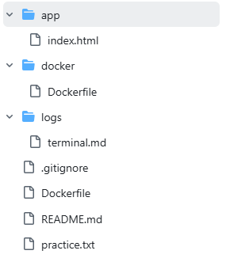

# 개발 워크스테이션 구축 미션


## 1. 프로젝트 개요

### 1-1. 미션 목표

본 프로젝트는 개발 환경 구축에 필요한 기본적인 도구와 기술을 직접 설치하고 실습하여 개발 워크스테이션의 기본적인 구성 및 운영 방법을 익히는 것을 목표로 한다.

### 1-2. 주요 수행 내용

- Windows 환경에서 개발 도구 및 터미널 사용
- Linux 기본 명령어와 파일 권한 관리
- Docker 이미지 및 컨테이너 생성·실행·관리
- Dockerfile을 활용한 커스텀 웹 서버 구축
- 바인드 마운트와 Docker Volume을 활용한 데이터 관리
- Git을 활용한 버전 관리 및 GitHub 연동
- 실습 과정과 결과를 README로 문서화

### 1-3. 최종 목표

개발 워크스테이션의 기본 구성 요소를 이해하고, Docker 기반의 웹 서버를 직접 구축하며, GitHub를 통해 프로젝트를 관리하고 공유할 수 있는 기본 역량을 확보한다.


## 2. 개발환경

| 항목 | 환경 |
|---|---|
| OS | Windows |
| Docker | Installed |
| Git | Installed |
| 개발 경험 | Beginner |
| 터미널 | PowerShell |
| 편집기 | VSCode |

### 2-1. PowerShell 버전 확인

실행 명령어:
```powershell
$PSVersionTable
```

실행 결과
```
Name                           Value                                                               
----                           -----                                                               
PSVersion                      5.1.19041.6456                                                      
PSEdition                      Desktop                                                             
PSCompatibleVersions           {1.0, 2.0, 3.0, 4.0...}                                             
BuildVersion                   10.0.19041.6456                                                     
CLRVersion                     4.0.30319.42000                                                     
WSManStackVersion              3.0                                                                 
PSRemotingProtocolVersion      2.3                                                                 
SerializationVersion           1.1.0.1              
```

### 2-2. Window 운영체제 확인

실행 명령어:
```powershell
systeminfo
```

실행 결과
```
OS 이름:                 Microsoft Windows 10 Home
OS 버전:                 10.0.19045 N/A 빌드 19045
OS 제조업체:             Microsoft Corporation
OS 구성:                 독립 실행형 워크스테이션
OS 빌드 종류:            Multiprocessor Free
등록된 소유자:           K'
시스템 제조업체:         Dell Inc.
시스템 모델:             G3 3779
시스템 종류:             x64-based PC
프로세서:                프로세서 1개 설치됨
                         [01]: Intel64 Family 6 Model 158 Stepping 10 GenuineIntel ~2208Mhz
BIOS 버전:               Dell Inc. 1.5.1, 2018-11-01
시스템 로캘:             ko;한국어
입력 로캘:               ko;한국어
표준 시간대:             (UTC+09:00) 서울
총 실제 메모리:          8,049MB
사용 가능한 실제 메모리: 1,748MB
```

### 2-3. git 버전 확인

실행 명령어:
```powershell
git --version
```

실행 결과
```
git version 2.56.0.windows.4
```

### 2-4. Docker 버전 확인

실행 명령어:
```
docker --version
```

실행 결과
```
Docker version 29.9.2, build a82e528
```

실행 명령어:
```
docker desktop version
```

실행 결과
```
Docker Desktop CLI plugin version: 4.97.0
```

### 2-5. Docker 클라이언트 및 서버 확인

실행 명령어:
```powershell
docker info
```

실행 결과
```
Client:
 Version:    29.9.2
 Context:    desktop-linux
 Debug Mode: false
 Plugins:
  agent: Docker AI Agent Runner (Docker Inc.)
    Version:  v1.152.0
    Path:     C:\Users\K'\.docker\cli-plugins\docker-agent.exe
  ai: Docker AI Agent - Ask Gordon (Docker Inc.)
    Version:  v1.33.0
    Path:     C:\Users\K'\.docker\cli-plugins\docker-ai.exe
  buildx: Docker Buildx (Docker Inc.)
    Version:  v0.38.1
    Path:     C:\Users\K'\.docker\cli-plugins\docker-buildx.exe
  compose: Docker Compose (Docker Inc.)
    Version:  v5.6.1
    Path:     C:\Users\K'\.docker\cli-plugins\docker-compose.exe
  debug: Get a shell into any image or container (Docker Inc.)
    Version:  0.49.0
    Path:     C:\Users\K'\.docker\cli-plugins\docker-debug.exe
  desktop: Docker Desktop commands (Docker Inc.)
    Version:  4.97.0
    Path:     C:\Users\K'\.docker\cli-plugins\docker-desktop.exe
  dhi: CLI for managing Docker Hardened Images (Docker Inc.)
    Version:  v0.0.9
    Path:     C:\Users\K'\.docker\cli-plugins\docker-dhi.exe
  extension: Manages Docker extensions (Docker Inc.)
    Version:  v0.2.32
    Path:     C:\Users\K'\.docker\cli-plugins\docker-extension.exe
  init: Creates Docker-related starter files for your project (Docker Inc.)
    Version:  v1.4.1
    Path:     C:\Users\K'\.docker\cli-plugins\docker-init.exe
  mcp: Docker MCP Plugin (Docker Inc.)
    Version:  v0.44.2
    Path:     C:\Users\K'\.docker\cli-plugins\docker-mcp.exe
  model: Docker Model Runner (Docker Inc.)
    Version:  v1.2.9
    Path:     C:\Users\K'\.docker\cli-plugins\docker-model.exe
  offload: Docker Offload (Docker Inc.)
    Version:  v0.7.21
    Path:     C:\Users\K'\.docker\cli-plugins\docker-offload.exe
  pass: Docker Pass Secrets Manager Plugin (beta) (Docker Inc.)
    Version:  v0.3.2
    Path:     C:\Users\K'\.docker\cli-plugins\docker-pass.exe
  sandbox: "docker sandbox" is deprecated, use Docker Sandboxes instead (Docker Inc.)
    Version:  v0.13.0
    Path:     C:\Users\K'\.docker\cli-plugins\docker-sandbox.exe
  scout: Docker Scout (Docker Inc.)
    Version:  v1.27.0
    Path:     C:\Users\K'\.docker\cli-plugins\docker-scout.exe

Server:
 Containers: 0
  Running: 0
  Paused: 0
  Stopped: 0
 Images: 0
 Server Version: 29.9.2
 Storage Driver: overlayfs
  driver-type: io.containerd.snapshotter.v1
 Logging Driver: local
 Cgroup Driver: cgroupfs
 Cgroup Version: 2
 Plugins:
  Volume: local
  Network: bridge host ipvlan macvlan null overlay
  Log: awslogs fluentd gcplogs gelf journald json-file local splunk syslog
 CDI spec directories:
  /etc/cdi
  /var/run/cdi
 Discovered Devices:
  cdi: docker.com/gpu=webgpu
 Swarm: inactive
 Runtimes: io.containerd.runc.v2 nvidia runc
 Default Runtime: runc
 Init Binary: docker-init
 containerd version: b7a25261e029d68978bbf290df0a62fc819b3c51
 runc version: v1.5.2-0-g29dd3dc2
 init version: de40ad0
 Security Options:
  seccomp
   Profile: builtin
  cgroupns
 Kernel Version: 6.18.40.1-microsoft-standard-WSL2
 Operating System: Docker Desktop
 OSType: linux
 Architecture: x86_64
 CPUs: 12
 Total Memory: 3.755GiB
 Name: docker-desktop
 ID: 6844b9c5-907f-4a56-bf6f-aefe9f3f34b9
 Docker Root Dir: /var/lib/docker
 Debug Mode: false
 HTTP Proxy: http.docker.internal:3128
 HTTPS Proxy: http.docker.internal:3128
 No Proxy: hubproxy.docker.internal
 Labels:
  com.docker.desktop.address=npipe://\\.\pipe\docker_cli
 Experimental: false
 Insecure Registries:
  hubproxy.docker.internal:5555
  127.0.0.0/8
  ::1/128
 Live Restore Enabled: false
 Firewall Backend: iptables
```

```
추가 설명
- Docker Client: 사용자 명령어를 입력하는 클라이언트
- Docker Server: 실제 컨테이너와 이미지를 관리하는 Docker 엔진
- Context: desktop-linux 환경을 통해 Docker Desktop의 Linux 엔진에 연결
- Operating System: Docker Desktop의 Linux 기반 실행 환경
```

## 3. 폴더/파일 생성 및 이동 등

### 3-1. 폴더 생성 및 확인

실행 명령어:
```
mkdir app
mkdir docker
mkdir docker-data
mkdir practice
mkdir logs
mkdir screenshots
Get-ChildItem
```

실행 결과
```
Mode                 LastWriteTime         Length Name                                             
----                 -------------         ------ ----                                             
d-----      2026-11-02   오후 2:55                app                                              
d-----      2026-11-02   오후 2:55                docker                                           
d-----      2026-11-02   오후 2:55                docker-data                                      
d-----      2026-11-02   오후 3:33                logs                                             
d-----      2026-11-02   오후 2:55                practice                                         
d-----      2026-11-02   오후 2:55                screenshots                                      
-a----      2026-11-02   오후 3:30           6405 README.md 
```

실행 명령어:
```
Get-ChildItem -Force
```

실행 결과
```
Mode                 LastWriteTime         Length Name                                  
----                 -------------         ------ ----                                  
d--h--      2026-11-04   오후 5:19                .git                                  
d-----      2026-11-03   오후 3:36                app                                   
d-----      2026-11-03   오후 3:32                dev-workstation-mission               
d-----      2026-11-03   오후 3:43                docker                                
d-----      2026-11-02   오후 2:55                docker-data                           
d-----      2026-11-04   오후 5:10                images                                
d-----      2026-11-02   오후 3:33                logs                                  
d-----      2026-11-02   오후 2:55                practice                              
d-----      2026-11-02   오후 2:55                screenshots                           
d-----      2026-11-02   오후 3:46                test-folder                           
-a----      2026-11-04   오후 1:02             96 .gitignore                            
-a----      2026-11-03   오후 3:48             86 Dockerfile                            
-a----      2026-11-04   오후 1:46          11690 image.png                             
-a----      2026-11-02   오후 3:55             18 practice.txt                          
-a----      2026-11-05   오전 2:32          43573 README.md        
```

### 3-2. test폴더 생성 및 이동

실행 명령어:
```
mkdir test-folder
cd test-folder
pwd
cd ..
```

실행 결과
```

    디렉터리: C:\Users\K'\my-first-docker


Mode                 LastWriteTime         Length Name                                             
----                 -------------         ------ ----                                             
d-----      2026-11-02   오후 3:46                test-folder                                      

Drive        : C
Provider     : Microsoft.PowerShell.Core\FileSystem
ProviderPath : C:\Users\K'\my-first-docker\test-folder
Path         : C:\Users\K'\my-first-docker\test-folder
```

```
추가설명
- 절대 경로: 드라이브 또는 루트부터 시작하는 전체 경로
  예: C:\Users\K'\my-first-docker\app

- 상대 경로: 현재 작업 위치를 기준으로 표현하는 경로
  예: .\app\index.html
```


### 3-3. 파일 생성 및 내용 입력

실행 명령어:
```
New-Item practice.txt -ItemType File
Set-Content practice.txt "Hello, Codyssey!"
Get-Content practice.txt
```

실행 결과
```

    디렉터리: C:\Users\K'\my-first-docker


Mode                 LastWriteTime         Length Name                                             
----                 -------------         ------ ----                                             
-a----      2026-11-02   오후 3:55              0 practice.txt                                     
Hello, Codyssey!
```

### 3-4. 파일 복사, 이름 변경, 삭제

실행 명령어:
```
Copy-Item practice.txt practice-copy.txt
Rename-Item practice-copy.txt renamed-file.txt
Get-ChildItem
Remove-Item renamed-file.txt
```

실행 결과
```
 디렉터리: C:\Users\K'\my-first-docker


Mode                 LastWriteTime         Length Name                                             
----                 -------------         ------ ----                                             
d-----      2026-11-02   오후 2:55                app                                              
d-----      2026-11-02   오후 2:55                docker                                           
d-----      2026-11-02   오후 2:55                docker-data                                      
d-----      2026-11-02   오후 3:33                logs                                             
d-----      2026-11-02   오후 2:55                practice                                         
d-----      2026-11-02   오후 2:55                screenshots                                      
d-----      2026-11-02   오후 3:46                test-folder                                      
-a----      2026-11-02   오후 3:55             18 practice.txt                                     
-a----      2026-11-02   오후 3:56           9750 README.md                                        
-a----      2026-11-02   오후 3:55             18 renamed-file.txt   
```

## 4. Linux 파일 권한 관련

### 4-1. WSL 설치 여부 확인

실행 명령어:
```
powershell
wsl --list --verbose
```

실행 결과
```
 NAME              STATE           VERSION
* docker-desktop    Stopped         2
  Ubuntu            Stopped         2
  ```

### 4-2. Ubuntu 실행

실행 명령어:
```
wsl -d Ubuntu
```

실행 결과
```
ooooo@ks-11:/mnt/c/Users/K'/my-first-docker$ 
```

### 4-3. 실습 폴더 및 파일 생성

실행 명령어:
```
mkdir -p ~/mission-practice
cd ~/mission-practice
touch test.txt
ls -l
```

실행 결과
```
-rw-r--r-- 1 ooooo ooooo 0 Nov  3 13:01 test.txt
```

### 4-4. 파일 권한 변경

실행 명령어:
```
chmod 600 test.txt
ls -l test.txt
```

실행 결과
```
-rw------- 1 ooooo ooooo 0 Nov  3 13:01 test.txt
```

### 4-5. 파일 권한 변경2

실행 명령어:
```
chmod 700 test.txt
ls -l test.txt
```

실행 결과
```
-rwx------ 1 ooooo ooooo 0 Nov  3 13:01 test.txt
```

### 4-6. 디렉토리 권한 변경

실행 명령어: 실습 환경 확인
```
cd ~
pwd
df -T .
```

실행 결과: WSL의 Linux 전용 파일시스템인 ext4 환경에서 실습 진행
```
/home/genik
Filesystem     Type  1K-blocks    Used  Available Use% Mounted on
/dev/sdd       ext4 1055762868 1353440 1000705956   1% /
```

실행 명령어: 디렉터리 생성 및 초기 권한 확인
```
mkdir -p permission-test
ls -ld permission-test
```

실행 명령어: 권한을 755로 변경
```
chmod 755 permission-test
ls -ld permission-test
```

실행 결과: 
```
drwxr-xr-x 2 genik genik 4096 Nov  5 04:15 permission-test
```

실행 명령어: 권한을 700으로 변경
```
chmod 700 permission-test
ls -ld permission-test
```

실행 결과
```
drwx------ 2 genik genik 4096 Nov  5 04:15 permission-test
```

```
추가설명
권한	숫자	의미
r	4	읽기
w	2	쓰기
x	1	실행

755 = 7(4+2+1) / 5(4+1) / 5(4+1)

- 소유자: 읽기, 쓰기, 실행
- 그룹: 읽기, 실행
- 기타 사용자: 읽기, 실행

644 = 6(4+2) / 4 / 4

- 소유자: 읽기, 쓰기
- 그룹: 읽기
- 기타 사용자: 읽기
```

### 4-7. Ubuntu 실행 종료

실행 명령어:
```
exit
```

실행 결과
```
logout
```

## 5. Docker 활용 실습

### 5-1. Docker 엔진 상태 확인

실행 명령어:
```
powershell
docker info
```

실행 결과
```
Client:
 Version:    29.9.2
 Context:    desktop-linux
 Debug Mode: false
 Plugins:
  agent: Docker AI Agent Runner (Docker Inc.)
    Version:  v1.152.0
    Path:     C:\Users\K'\.docker\cli-plugins\docker-agent.exe
  ai: Docker AI Agent - Ask Gordon (Docker Inc.)
    Version:  v1.33.0
    Path:     C:\Users\K'\.docker\cli-plugins\docker-ai.exe
  buildx: Docker Buildx (Docker Inc.)
    Version:  v0.38.1
    Path:     C:\Users\K'\.docker\cli-plugins\docker-buildx.exe
  compose: Docker Compose (Docker Inc.)
    Version:  v5.6.1
    Path:     C:\Users\K'\.docker\cli-plugins\docker-compose.exe
  debug: Get a shell into any image or container (Docker Inc.)
    Version:  0.49.0
    Path:     C:\Users\K'\.docker\cli-plugins\docker-debug.exe
  desktop: Docker Desktop commands (Docker Inc.)
    Version:  4.97.0
    Path:     C:\Users\K'\.docker\cli-plugins\docker-desktop.exe
  dhi: CLI for managing Docker Hardened Images (Docker Inc.)
    Version:  v0.0.9
    Path:     C:\Users\K'\.docker\cli-plugins\docker-dhi.exe
  extension: Manages Docker extensions (Docker Inc.)
    Version:  v0.2.32
    Path:     C:\Users\K'\.docker\cli-plugins\docker-extension.exe
  init: Creates Docker-related starter files for your project (Docker Inc.)
    Version:  v1.4.1
    Path:     C:\Users\K'\.docker\cli-plugins\docker-init.exe
  mcp: Docker MCP Plugin (Docker Inc.)
    Version:  v0.44.2
    Path:     C:\Users\K'\.docker\cli-plugins\docker-mcp.exe
  model: Docker Model Runner (Docker Inc.)
    Version:  v1.2.9
    Path:     C:\Users\K'\.docker\cli-plugins\docker-model.exe
  offload: Docker Offload (Docker Inc.)
    Version:  v0.7.21
    Path:     C:\Users\K'\.docker\cli-plugins\docker-offload.exe
  pass: Docker Pass Secrets Manager Plugin (beta) (Docker Inc.)
    Version:  v0.3.2
    Path:     C:\Users\K'\.docker\cli-plugins\docker-pass.exe
  sandbox: "docker sandbox" is deprecated, use Docker Sandboxes instead (Docker Inc.)
    Version:  v0.13.0
    Path:     C:\Users\K'\.docker\cli-plugins\docker-sandbox.exe
  scout: Docker Scout (Docker Inc.)
    Version:  v1.27.0
    Path:     C:\Users\K'\.docker\cli-plugins\docker-scout.exe

Server:
 Containers: 0
  Running: 0
  Paused: 0
  Stopped: 0
 Images: 0
 Server Version: 29.9.2
 Storage Driver: overlayfs
  driver-type: io.containerd.snapshotter.v1
 Logging Driver: local
 Cgroup Driver: cgroupfs
 Cgroup Version: 2
 Plugins:
  Volume: local
  Network: bridge host ipvlan macvlan null overlay
  Log: awslogs fluentd gcplogs gelf journald json-file local splunk syslog
 CDI spec directories:
  /etc/cdi
  /var/run/cdi
 Discovered Devices:
  cdi: docker.com/gpu=webgpu
 Swarm: inactive
 Runtimes: nvidia runc io.containerd.runc.v2
 Default Runtime: runc
 Init Binary: docker-init
 containerd version: b7a25261e029d68978bbf290df0a62fc819b3c51
 runc version: v1.5.2-0-g29dd3dc2
 init version: de40ad0
 Security Options:
  seccomp
   Profile: builtin
  cgroupns
 Kernel Version: 6.18.40.1-microsoft-standard-WSL2
 Operating System: Docker Desktop
 OSType: linux
 Architecture: x86_64
 CPUs: 12
 Total Memory: 3.755GiB
 Name: docker-desktop
 ID: 6844b9c5-907f-4a56-bf6f-aefe9f3f34b9
 Docker Root Dir: /var/lib/docker
 Debug Mode: false
 HTTP Proxy: http.docker.internal:3128
 HTTPS Proxy: http.docker.internal:3128
 No Proxy: hubproxy.docker.internal
 Labels:
  com.docker.desktop.address=npipe://\\.\pipe\docker_cli
 Experimental: false
 Insecure Registries:
  hubproxy.docker.internal:5555
  127.0.0.0/8
  ::1/128
 Live Restore Enabled: false
 Firewall Backend: iptables
 ```

### 5-2. 첫 번째 컨테이너 실행

실행 명령어:
```
docker run hello-world
```

실행 결과
```
Unable to find image 'hello-world:latest' locally
latest: Pulling from library/hello-world
4f55086f7dd0: Pull complete 
d5e71e642bf5: Download complete 
Digest: sha256:c567b231f65614688711a75f31518a064258a51d442117a3e771a3a8fdba78ef
Status: Downloaded newer image for hello-world:latest

Hello from Docker!
This message shows that your installation appears to be working correctly.

To generate this message, Docker took the following steps:
 1. The Docker client contacted the Docker daemon.
 2. The Docker daemon pulled the "hello-world" image from the Docker Hub.
    (amd64)
 3. The Docker daemon created a new container from that image which runs the
    executable that produces the output you are currently reading.
 4. The Docker daemon streamed that output to the Docker client, which sent it
    to your terminal.

To try something more ambitious, you can run an Ubuntu container with:
 $ docker run -it ubuntu bash

Share images, automate workflows, and more with a free Docker ID:
 https://hub.docker.com/

For more examples and ideas, visit:
 https://docs.docker.com/get-started/
 ```

### 5-3. Ubuntu 컨테이너 실행

실행 명령어:
```
docker run -it --name mission-ubuntu ubuntu:latest bash
```

실행 결과
```
Unable to find image 'ubuntu:latest' locally
latest: Pulling from library/ubuntu
f3f25b84a7d7: Pull complete 
edafa32f5d9e: Pull complete 
21594acc2d8b: Download complete 
Digest: sha256:6a06111c3b0a8600feadb270aec771dc239bf407b25625f93f44ab00e11f4d3c
Status: Downloaded newer image for ubuntu:latest
```

### 5-4. 내부 명령어 실행

실행 명령어: 현재 위치 확인
```
pwd
```

실행 명령어: 파일 및 디렉토리 목록
```
ls -la
```

실행 결과
```
drwxr-xr-x   1 root root 4096 Nov  4 17:19 .
drwxr-xr-x   1 root root 4096 Nov  4 17:19 ..
-rwxr-xr-x   1 root root    0 Nov  4 17:19 .dockerenv
drwxr-xr-x   2 root root 4096 Oct 25 10:26 .rock
lrwxrwxrwx   1 root root    7 Apr 20  2026 bin -> usr/bin
drwxr-xr-x   2 root root 4096 Apr 20  2026 boot
drwxr-xr-x   5 root root  360 Nov  4 17:19 dev
drwxr-xr-x   1 root root 4096 Nov  4 17:19 etc
drwxr-xr-x   3 root root 4096 Oct 25 10:26 home
lrwxrwxrwx   1 root root    7 Apr 20  2026 lib -> usr/lib
lrwxrwxrwx   1 root root    9 Apr 20  2026 lib64 -> usr/lib64
drwxr-xr-x   2 root root 4096 Oct 25 10:25 media
drwxr-xr-x   2 root root 4096 Oct 25 10:25 mnt
drwxr-xr-x   2 root root 4096 Oct 25 10:25 opt
dr-xr-xr-x 211 root root    0 Nov  4 17:19 proc
drwx------   2 root root 4096 Oct 25 10:26 root
drwxr-xr-x   4 root root 4096 Oct 25 10:26 run
lrwxrwxrwx   1 root root    8 Apr 20  2026 sbin -> usr/sbin
drwxr-xr-x   2 root root 4096 Oct 25 10:25 srv
dr-xr-xr-x  12 root root    0 Nov  4 17:19 sys
drwxrwxrwt   2 root root 4096 Oct 25 10:25 tmp
drwxr-xr-x  12 root root 4096 Oct 25 10:24 usr
drwxr-xr-x  11 root root 4096 Oct 25 10:26 var
```

실행 명령어: 메시지 출력
```
echo "Hello Docker Ubuntu"
```

실행 결과
```
Hello Docker Ubuntu
```

실행 명령어: 파일 생성
```
touch test.txt
```

실행 명령어: 파일 내용 작성
```
echo "Ubuntu Container Test" > test.txt
```

실행 명령어: 파일 내용 확인
```
cat test.txt
```

실행 결과
```
Ubuntu Container Test
```

실행 명령어: 파일 확인
```
cat test.txt
```

실행 결과
```
-rw-r--r-- 1 root root 22 Nov  4 17:23 test.txt
```

### 5-5. 컨테이너 종료 및 유지 방식 이해

실행 명령어:
```
exit
```

실행 명령어: 컨테이너 상태 확인
```
docker ps -a
```

실행 결과
```
CONTAINER ID   IMAGE                COMMAND                   CREATED         STATUS                        PORTS                  NAMES
a39bc771f2c1   ubuntu:latest        "bash"                    9 minutes ago   Exited (0) 21 seconds ago  
```

실행 명령어: 컨테이너 재 실행
```
docker start mission-ubuntu
```

실행 결과
```
mission-ubuntu
```

실행 명령어: 컨테이너 내부로 진입
```
docker exec -it mission-ubuntu bash
```

실행 명령어: 이전 작성 파일 존재 여부 확인
```
cat test.txt
```

실행 결과
```
Ubuntu Container Test
```

### 5-6. 컨테이너 상태 확인

실행 명령어:
```
docker ps
docker ps -a
docker images
```

실행 결과
```
CONTAINER ID   IMAGE     COMMAND   CREATED   STATUS    PORTS     NAMES
CONTAINER ID   IMAGE           COMMAND    CREATED         STATUS                      PORTS     NAMES
8325a9987829   ubuntu:latest   "bash"     3 minutes ago   Exited (0) 43 seconds ago             mission-ubuntu
d03ce15efe5d   hello-world     "/hello"   7 minutes ago   Exited (0) 7 minutes ago              upbeat_mestorf
                                                                   i Info →   U  In Use
IMAGE                ID             DISK USAGE   CONTENT SIZE   EXTRA
hello-world:latest   c567b231f656       25.9kB         9.49kB    U   
ubuntu:latest        6a06111c3b0a        163MB         45.9MB    U   
```

### 5-7. 컨테이너 로그 및 관리

실행 명령어:
```
docker start mission-ubuntu
docker logs mission-ubuntu
docker stop mission-ubuntu
docker rm mission-ubuntu
```

실행 결과
```
mission-ubuntu
root@a39bc771f2c1:/# pwd
/
root@a39bc771f2c1:/# ls -la
total 60
drwxr-xr-x   1 root root 4096 Nov  4 17:19 .
drwxr-xr-x   1 root root 4096 Nov  4 17:19 ..
-rwxr-xr-x   1 root root    0 Nov  4 17:19 .dockerenv
drwxr-xr-x   2 root root 4096 Oct 25 10:26 .rock
lrwxrwxrwx   1 root root    7 Apr 20  2026 bin -> usr/bin
drwxr-xr-x   2 root root 4096 Apr 20  2026 boot
drwxr-xr-x   5 root root  360 Nov  4 17:19 dev
drwxr-xr-x   1 root root 4096 Nov  4 17:19 etc
drwxr-xr-x   3 root root 4096 Oct 25 10:26 home
lrwxrwxrwx   1 root root    7 Apr 20  2026 lib -> usr/lib
lrwxrwxrwx   1 root root    9 Apr 20  2026 lib64 -> usr/lib64
drwxr-xr-x   2 root root 4096 Oct 25 10:25 media
drwxr-xr-x   2 root root 4096 Oct 25 10:25 mnt
drwxr-xr-x   2 root root 4096 Oct 25 10:25 opt
dr-xr-xr-x 211 root root    0 Nov  4 17:19 proc
drwx------   2 root root 4096 Oct 25 10:26 root
drwxr-xr-x   4 root root 4096 Oct 25 10:26 run
lrwxrwxrwx   1 root root    8 Apr 20  2026 sbin -> usr/sbin
drwxr-xr-x   2 root root 4096 Oct 25 10:25 srv
dr-xr-xr-x  12 root root    0 Nov  4 17:19 sys
drwxrwxrwt   2 root root 4096 Oct 25 10:25 tmp
drwxr-xr-x  12 root root 4096 Oct 25 10:24 usr
drwxr-xr-x  11 root root 4096 Oct 25 10:26 var
root@a39bc771f2c1:/# echo "Hello Docker Ubuntu"
Hello Docker Ubuntu
root@a39bc771f2c1:/# touch test.txt
root@a39bc771f2c1:/# echo "Ubuntu Container Test" > test.txt
root@a39bc771f2c1:/# cat test.txt
Ubuntu Container Test
root@a39bc771f2c1:/# ls -l test.txt
-rw-r--r-- 1 root root 22 Nov  4 17:23 test.txt
root@a39bc771f2c1:/# exit
exit
mission-ubuntu
mission-ubuntu
```

### 5-8. attach와 exec 차이 확인

실행 명령어:
```
docker run -dit --name mission-test ubuntu:latest bash
```

실행 결과
```
bf5e6415efc3ea19c1136d9e78e82bd2a35eafeefce9943cd91f53d1c30eee5b
```

실행 명령어:
```
docker exec mission-test bash
```

실행 명령어:
```
docker attach mission-test
```

실행 결과
```
root@bf5e6415efc3:/# 
```
```
컨테이너에서 빠져나올때는 Ctrl + P를 누른 뒤 Ctrl + Q를 눌러서 컨테이너를 종료하지 않고 연결만 종료할 수 있음.
```

실행 명령어:
```
docker stop mission-test
docker rm mission-test
```

실행 결과
```
mission-test
mission-test
```

```
추가설명
- docker exec: 실행 중인 컨테이너에 새로운 프로세스를 실행하여 접속.
- docker attach: 컨테이너의 기존 주 프로세스에 연결.

exec는 별도의 셸을 실행하는 방식이며,
attach는 기존 프로세스의 입출력에 연결하는 방식.
```

### 5-9. 기타 Docker 관리 명령어

실행 명령어:
```
docker run -d --name stats-test nginx:latest
docker stats --no-stream
docker stop stats-test
docker rm stats-test
```

실행 결과
```
2a4dda1fb87b4c862ca02f37621be3e0cefd079a24ce91457064c30c0f9a2dfe
CONTAINER ID   NAME         CPU %     MEM USAGE / LIMIT     MEM %     NET I/O      BLOCK I/O         PIDS
2a4dda1fb87b   stats-test   0.00%     15.95MiB / 3.755GiB   0.41%     690B / 84B   17.5MB / 8.19kB   13
stats-test
stats-test
```

### 5-10. 이미지와 컨테이너의 차이

```
- Docker 이미지: 컨테이너를 생성하기 위한 실행 템플릿
- Docker 컨테이너: 이미지를 기반으로 생성되어 실행되는 독립적인 환경

- 이미지는 빌드하여 생성하고, 컨테이너는 이미지를 실행하여 생성한다.
- 컨테이너 내부에서 변경한 내용은 기본적으로 해당 컨테이너의 쓰기 가능 계층에 저장되며, 컨테이너 삭제 시 함께 사라질 수 있음
```

## 6. Dockerfile 작성 및 커스텀 웹 서버 구축

### 6-1. HTML 파일 작성

실행 명령어:
```
New-Item app/index.html -ItemType File
```

실행 결과
```

    디렉터리: C:\Users\K'\my-first-docker\app


Mode                 LastWriteTime         Length Name                                 
----                 -------------         ------ ----                                 
-a----      2026-11-03   오후 3:36              0 index.html       
```

실행 명령어: app/index.html을 열고 다음 내용을 입력
```
<!DOCTYPE html>
<html lang="ko">
<head>
    <meta charset="UTF-8">
    <title>My Docker Web Server</title>
</head>
<body>
    <h1>Hello, Docker!</h1>
    <p>내 첫번째 custom web server.</p>
    <p>Mission을 위한 첫단계!</p>
</body>
</html>
```

### 6-2. Dockerfile 작성

실행 명령어:
```
New-Item Dockerfile -ItemType File
```

실행 결과
```
 디렉터리: C:\Users\K'\my-first-docker
```

실행 명령어:
```
notepad Dockerfile
```

실행 결과
```
메모장이 실행되면서 Dockerfile을 작성할 수 있음. 
```

실행 명령어: Dockerfile 메모장에 작성
```
FROM nginx:latest

COPY app/index.html /usr/share/nginx/html/index.html

EXPOSE 80
```

실행 결과
```
파일 저장 시 아래와 같이 저장.
파일 이름: Dockerfile
파일 형식: 모든 파일
인코딩: UTF-8
확장자: 없음
```

```
추가설명
- FROM: 기존 NGINX 이미지를 베이스 이미지로 지정
- COPY: 호스트의 HTML 파일을 컨테이너 내부 웹 서버 경로에 복사
- EXPOSE: 컨테이너가 서비스에 사용할 포트 80을 문서화 함
```

### 6-3. Docker image build

실행 명령어:
```
docker build -t my-webserver:v1 -f .\Dockerfile .
```

실행 결과
```
[+] Building 2.2s (7/7) FINISHED                                    docker:desktop-linux
 => [internal] load build definition from Dockerfile                                0.1s
 => => transferring dockerfile: 123B                                                0.0s
 => [internal] load metadata for docker.io/library/nginx:latest                     0.2s
 => [internal] load .dockerignore                                                   0.1s
 => => transferring context: 2B                                                     0.0s
 => [internal] load build context                                                   0.1s
 => => transferring context: 334B                                                   0.0s
 => CACHED [1/2] FROM docker.io/library/nginx:latest@sha256:5ab5b0b01097420873a3f3  0.1s
 => => resolve docker.io/library/nginx:latest@sha256:5ab5b0b01097420873a3f3330f442  0.1s
 => [2/2] COPY app/index.html /usr/share/nginx/html/index.html                      0.2s
 => exporting to image                                                              1.1s
 => => exporting layers                                                             0.4s
 => => exporting manifest sha256:a157b6353416cbecae6cb0f49c2aed06426efe40395f428b0  0.1s
 => => exporting config sha256:6e6016be68ecbf87b9df8adc4644d041576c38f7136a14f3425  0.1s
 => => exporting attestation manifest sha256:9910344a4445ba3f2487ce006063acabbb6b1  0.1s
 => => exporting manifest list sha256:f438ee662f7fba7224a9f70f386fe091d19d644e67fa  0.1s
 => => naming to docker.io/library/my-webserver:v1                                  0.0s
 => => unpacking to docker.io/library/my-webserver:v1         
 ```

```
추가설명
기존 베이스 이미지: nginx:latest

커스텀 이미지: my-webserver:v1

기존 NGINX 이미지에 직접 작성한 index.html을 추가하여 커스텀 이미지를 제작하였음.
```

 ### 6-4. 웹 서버 컨테이너 실행

실행 명령어:
```
docker run -d -p 8080:80 --name my-webserver-container my-webserver:v1
```

실행 결과
```
주소창에 http://localhost:8080를 입력하면 새 웹페이지가 뜨면서 설정했던 텍스트가 출력됨.
Hello, Docker!
내 첫번째 custom web server.
Mission을 위한 첫단계!
```

### 6-5. 웹 서버 컨테이너 검증

실행 명령어:
```
curl.exe http://localhost:8080
```

실행 결과
```
<!DOCTYPE html>
<html lang="ko">
<head>
    <meta charset="UTF-8">
    <title>My Docker Web Server</title>
</head>
<body>
    <h1>Hello, Docker!</h1>
    <p>내 첫번째 custom web server.</p>
    <p>Mission을 위한 첫단계!</p>
</body>
</html>
```

## 7. 바인드 마운트 실습

### 7-1. 기존 컨테이너 중지 및 삭제

실행 명령어: 실행중인 경우 같은 포트를 사용할 수 없음.
```
docker stop mission-bind
docker rm mission-bind
```

실행 결과
```
mission-bind
```

### 7-2. 바인드 마운트로 컨테이너 실행

실행 명령어: 
```
docker run -d --name mission-bind -p 8080:80 --mount "type=bind,source=$($PWD.Path)\app,target=/usr/share/nginx/html,readonly" nginx:latest
```

실행 결과
```
source=$($PWD.Path)\app,target=/usr/share/nginx/html,readonly" nginx:latest
093155c2852451300fd269540307f774ecf5fff45893da5cb9e9a8e9df4b93ca
```

```
추가설명
- source: Windows 호스트의 app 디렉토리
- target: 컨테이너 내부의 웹 서버 콘텐츠 디렉토리
- readonly: 컨테이너에서 호스트 파일을 수정하지 못하도록 읽기 전용 설정
```

### 7-3. HTML 파일 수정

실행 명령어: Windows의 app/index.html 파일 수정 
```
<h1>Hello, Bind Mount!</h1>
```

실행 결과: 브라우저에서 수정 내용 반영 확인

기존<br>
_최초.PNG)

변경 후<br>
.PNG)

```
추가설명
- 바인드 마운트는 호스트의 특정 파일 또는 디렉토리를 컨테이너 내부 경로에 연결하는 방식이므로, 호스트에서 HTML 파일을 변경하면 이미지를 다시 빌드하거나 컨테이너를 재생성하지 않아도 변경 내용이 컨테이너에 반영됨.

단, readonly 설정이므로 변경 작업은 호스트에서 수행해야 함.
```

## 8. Docker 볼륨을 이용한 데이터 영속성 실습

### 8-1. 볼륨 생성

실행 명령어: 
```
docker volume create mission-data
```

실행 결과
```
mission-data
```

### 8-2. 볼륨에 데이터 저장

실행 명령어: 
```
docker run -it --name volume-test -v mission-data:/data alpine sh
```

실행 결과
```
Unable to find image 'alpine:latest' locally
latest: Pulling from library/alpine
7b229517ed22: Pull complete 
3ec36f3670df: Download complete 
3da1513d2124: Download complete 
Digest: sha256:be2656061b536c1883c4034790e21d0a09c5aaaf51968b89368a3c0371ea2c9a
Status: Downloaded newer image for alpine:latest
```

실행 명령어: 컨테이너 내부에서 실행
```
echo "Docker Volume Persistence Test" > /data/test.txt
cat /data/test.txt
exit
```

실행 결과
```
Docker Volume Persistence Test
```

### 8-3. 컨테이너 삭제

실행 명령어: 
```
docker rm volume-test
```

실행 결과
```
volume-test
```

### 8-4. 새로운 컨테이너에서 데이터 확인

실행 명령어: 
```
docker run --rm -v mission-data:/data alpine cat /data/test.txt
```

실행 결과
```
Docker Volume Persistence Test
```

```
추가설명
- Docker Volume은 컨테이너를 독립적으로 데이터를 보존할 수 있는 저장 공간임. 컨테이너 내부의 일반 파일시스템에 데이터를 저장하면 컨테이너 삭제 시 데이터도 사라질 수 있지만, Docker Volume을 연결하면 데이터가 컨테이너 외부의 Docker 관리 저장 공간에 보존되므로 컨테이너를 삭제하더라도 새로운 컨테이너에서 기존 데이터를 다시 사용할 수 있음.

구분	               바인드 마운트	            Docker Volume
저장 위치	       호스트에서 지정한 경로   	Docker가 관리하는 저장 공간
주요 목적	       소스코드 및 파일 공유	    데이터 영속성
호스트 경로 지정	   필요	                    불필요
데이터 유지	       호스트 파일 유지	        컨테이너 삭제 후에도 유지
대표 활용	       웹 개발 및 파일 변경 반영	DB 및 서비스 데이터 보존
```

## 9. Git 및 Github 연동

### 9-1. Git 사용자 정보 확인

실행 명령어: 
```
git config --global user.name "ksdevl"
git config --global user.email "cela2323@google.com"
```

실행 명령어: 
```
git config --global init.defaultBranch main
git config --list
git branch --show-current
```

실행 결과
```
diff.astextplain.textconv=astextplain
filter.lfs.clean=git-lfs clean -- %f
filter.lfs.smudge=git-lfs smudge -- %f
filter.lfs.process=git-lfs filter-process
filter.lfs.required=true
http.sslbackend=schannel
core.autocrlf=true
core.fscache=true
core.symlinks=false
pull.rebase=false
```

### 9-2. Gitignore 작성

실행 명령어: 
```
New-Item .gitignore -ItemType File
```

실행 결과
```
 디렉터리: C:\Users\K'\my-first-docker


Mode                 LastWriteTime         Length Name                                     
----                 -------------         ------ ----                                     
-a----      2026-11-04   오전 3:12              0 .gitignore  
```

### 9-3. Git 저장소 초기화

실행 명령어: 
```
New-Item .gitignore -ItemType File
```

실행 결과: 기존 프로젝트 폴더가 저장소로 지정되어 있어서, 다시 저장소로 지정함.
```
warning: re-init: ignored --initial-branch=main
Reinitialized existing Git repository in C:/Users/K'/my-first-docker/.git/
```

실행 명령어: Git 상태 확인
```
git status
```

실행 결과
```
On branch main

No commits yet

Changes to be committed:
  (use "git rm --cached <file>..." to unstage)
        new file:   README.md
        new file:   logs/terminal.md
        new file:   practice.txt

Changes not staged for commit:
  (use "git add <file>..." to update what will be committed)
  (use "git restore <file>..." to discard changes in working directory)
        modified:   README.md

Untracked files:
  (use "git add <file>..." to include in what will be committed)
        .gitignore
        Dockerfile
        app/
        docker/
```

### 9-4. 파일 등록 및 첫번째 커밋

실행 명령어: 
```
git add .
git status
git commit -m "First workstation mission"
```

실행 결과
```
On branch main

No commits yet

Changes to be committed:
  (use "git rm --cached <file>..." to unstage)
        new file:   .gitignore
        new file:   Dockerfile
        new file:   README.md
        new file:   app/index.html
        new file:   docker/Dockerfile
        new file:   logs/terminal.md
        new file:   practice.txt

[main (root-commit) 8d1ce94] First workstation mission
 7 files changed, 1046 insertions(+)
 create mode 100644 .gitignore
 create mode 100644 Dockerfile
 create mode 100644 README.md
 create mode 100644 app/index.html
 create mode 100644 docker/Dockerfile
 create mode 100644 logs/terminal.md
 create mode 100644 practice.txt
 ```

### 9-5. Github 저장소 생성

### 9-6. Github에 업로드

실행 명령어: 
```
git remote add origin https://github.com/ksdevl/my-first-Docker.git
git push -u origin main
```

실행 결과: 
```
numerating objects: 15, done.
Counting objects: 100% (15/15), done.
Delta compression using up to 12 threads
Compressing objects: 100% (8/8), done.
Writing objects: 100% (13/13), 8.72 KiB | 2.18 MiB/s, done.
Total 13 (delta 1), reused 0 (delta 0), pack-reused 0 (from 0)
remote: Resolving deltas: 100% (1/1), done.
To https://github.com/ksdevl/my-first-Docker.git
   51a4285..898e245  main -> main
branch 'main' set up to track 'origin/main'.
```

### 9-7. 수정사항 업로드

실행 명령어: 
```
git add .
git commit -m "Update mission documentation"
git push
```

### 9-8. VSCode와 GitHub 연동 확인

```
1. VSCode 실행
2. 좌측 계정 메뉴에서 GitHub 로그인
3. 프로젝트 폴더 열기
4. Source Control에서 Git 저장소 확인
5. 원격 저장소 연결 상태 확인
6. GitHub 저장소와 프로젝트 파일이 동기화되는지 확인
```


## 10. 최종 Readme 및 증거자료 정리

### 10-1. 최종 폴더 구조

실행 명령어: 폴더구조 이미지를 저장하기 위한 디렉토리 생성
```
mkdir images
```

실행 결과: 
```
Mode                 LastWriteTime         Length Name                                  
----                 -------------         ------ ----                                  
d-----      2026-11-04   오후 1:52                images  
```

실행 결과



### 10-2. Readme에 스크린샷 연결 및 증거자료

1. Docker 실행<br>


2. 웹 서버 실행<br>
_최초.PNG)

3. 바인드 마운트<br>
.PNG)

4. 볼륨 데이터 영속성<br>


### 10-3. 최종 결과물 및 검증 증거 위치
```
검증 항목	      결과물 위치
프로젝트 설명	      README.md
웹 서버 소스코드	  app/index.html
Dockerfile	      Dockerfile
터미널 실습 기록	  logs/
Docker 실행 증거   images/
웹 서버 접속 증거	  images/
바인드 마운트 증거	  images/
볼륨 영속성 증거	  images/
프로젝트 구조       images/
```

### 10-4. 체크리스트
```
- [x] 터미널 기본 명령어 실습
- [x] 파일 및 디렉터리 권한 변경
- [x] Docker 설치 및 기본 명령어
- [x] Dockerfile 이미지 빌드
- [x] 포트 매핑 및 웹 서버 접속
- [x] 바인드 마운트
- [x] Docker Volume 영속성 검증
- [x] Git 및 GitHub 연동
- [x] 트러블슈팅
```

## 11. Troubleshooting 

### 11-1. Github에 업로드

실행 명령어: 
```
git remote add origin https://github.com/ksdevl/my-first-Docker.git
git push -u origin main
```

실행 결과: 기존 readme 저장소가 있어서 발생
```
error: remote origin already exists.
To https://github.com/ksdevl/my-first-Docker
 ! [rejected]        main -> main (fetch first)
hint: have locally. This is usually caused by another repository pushing to
hint: the same ref. If you want to integrate the remote changes, use
hint: 'git pull' before pushing again.
hint: See the 'Note about fast-forwards' in 'git push --help' for details.
```

```
원인 가설
- 로컬 저장소에 이미 origin이라는 원격 저장소가 등록되어 있음.
- 로컬 저장소와 GitHub 원격 저장소의 커밋 이력이 서로 다름.
```

실행 명령어: 저장소를 다시 세팅
```
git remote set-url origin https://github.com/ksdevl/my-first-Docker.git
```

실행 명령어: 수정되었는지 확인
```
git remote -v
```

실행 결과: 
```
origin  https://github.com/ksdevl/my-first-Docker.git (fetch)
origin  https://github.com/ksdevl/my-first-Docker.git (push)
```

실행 명령어: 원격 저장소의 변경사항을 가져오고, 별개로 시작한 저장소의 이력을 병합하도록 허용
```
git pull origin main --allow-unrelated-histories
```

실행 결과: 
```
remote: Enumerating objects: 3, done.
remote: Counting objects: 100% (3/3), done.
remote: Total 3 (delta 0), reused 0 (delta 0), pack-reused 0 (from 0)
Unpacking objects: 100% (3/3), 880 bytes | 29.00 KiB/s, done.
From https://github.com/ksdevl/my-first-Docker
 * branch            main       -> FETCH_HEAD
 * [new branch]      main       -> origin/main
Auto-merging README.md
CONFLICT (add/add): Merge conflict in README.md
Automatic merge failed; fix conflicts and then commit the result.
```

실행 명령어: Readme를 로컬파일 기준으로 선택
```
git checkout --ours README.md
```

실행 결과: 
```
Updated 1 path from the index
```

실행 명령어: 충돌 해결 및 병합 커밋 생성
```
git add README.md
git commit -m "Resolve merge conflict using local README"
```

실행 결과: 
```
[main 898e245] Resolve merge conflict using local README
```

실행 명령어: Github에 업로드
```
git push -u origin main
```

실행 결과: 
```
numerating objects: 15, done.
Counting objects: 100% (15/15), done.
Delta compression using up to 12 threads
Compressing objects: 100% (8/8), done.
Writing objects: 100% (13/13), 8.72 KiB | 2.18 MiB/s, done.
Total 13 (delta 1), reused 0 (delta 0), pack-reused 0 (from 0)
remote: Resolving deltas: 100% (1/1), done.
To https://github.com/ksdevl/my-first-Docker.git
   51a4285..898e245  main -> main
branch 'main' set up to track 'origin/main'.
```

```
해결 결과
- 로컬 README를 기준으로 병합 충돌을 해결하고 GitHub 원격 저장소에 정상적으로 업로드하였음

재발 방지
- 기존 원격 저장소의 존재 여부와 커밋 이력을 확인한 후 저장소를 연결하고 작업
```

### 11-2. 최종 폴더 구조

실행 명령어: 
```
"```"

"```"
```

실행 결과: 
```
Readme 미리보기 및 Github 업로드시 이미지가 보이지 않음.
```

```
원인 가설
- 이미지 파일 경로 또는 파일명이 실제 파일과 일치하지 않음
- Markdown 이미지 문법에 불필요한 백틱 포함
```

실행 명령어: 미리보기로 이미지가 뜨는지 확인
```
Ctrl + Shift + V
```

실행 결과: 
```
미리보기로 이미지가 보이지 않음
```

실행 명령어: 이미지 파일이 실제로 존재하는지 확인
```
Test-Path ".\images\폴더구조.png"
```

실행 결과: 이미지가 존재함 
```
True
```

실행 명령어: VS code에서 직접 이미지 오픈
```
code --reuse-window .\images\폴더구조.PNG
```

실행 결과: 이미지가 존재함 
```
이미지가 정상적으로 뜸
```

실행 명령어: `(백틱)이 존재해서 발생한 문제로, 백틱을 제거해서 해결
```

```

실행 결과


```
해결 결과
- 불필요한 백틱을 제거한 후 README 미리보기에서 이미지가 정상적으로 표시됨

재발 방지
- 이미지 파일명, 확장자, 상대 경로 및 Markdown 이미지 문법을 함께 확인
```

## 12. 최종 검증 

### 12-1. Docker 컨테이너, 이미지, 볼륨 Git, Github업로드 검증

실행 명령어: 
```
docker ps -a
docker images
docker volume ls
git status
```

실행 결과: 
```
CONTAINER ID   IMAGE                COMMAND                   CREATED          STATUS                      PORTS                                     NAMES
c20c56633869   hello-world          "/hello"                  20 minutes ago   Exited (0) 20 minutes ago                                             confident_kare
d5cf778bfb56   nginx:latest         "/docker-entrypoint.…"   25 hours ago     Up 25 minutes               0.0.0.0:8080->80/tcp, [::]:8080->80/tcp   mission-bind
3bc392aa5abe   my-webserver:v1      "/docker-entrypoint.…"   25 hours ago     Exited (0) 25 hours ago                                               my-webserver-container
b7b83abfca29   hello-world:latest   "/hello"                  27 hours ago     Exited (0) 27 hours ago                                               unruffled_kowalevski
d03ce15efe5d   hello-world          "/hello"                  28 hours ago     Exited (0) 28 hours ago                                               upbeat_mestorf
                                                                    i Info →   U  In Use
IMAGE                ID             DISK USAGE   CONTENT SIZE   EXTRA
alpine:latest        be2656061b53         13MB         3.94MB        
hello-world:latest   c567b231f656       25.9kB         9.49kB    U   
my-webserver:v1      114810bad594        241MB         63.9MB    U   
nginx:latest         5ab5b0b01097        243MB         66.8MB    U   
ubuntu:latest        6a06111c3b0a        163MB         45.9MB        
DRIVER    VOLUME NAME
local     mission-data
On branch main
Your branch is up to date with 'origin/main'.

Changes not staged for commit:
  (use "git add <file>..." to update what will be committed)
  (use "git restore <file>..." to discard changes in working directory)
        modified:   README.md

no changes added to commit (use "git add" and/or "git commit -a")
```

```
추가설명

명령어	           검증 목적
docker ps -a	   생성된 컨테이너와 실행 상태 확인
docker images	   생성된 Docker 이미지 확인
docker volume ls  생성된 Docker 볼륨 확인
git status	      로컬 저장소의 변경사항 및 원격 동기화 상태 확인
```

### 12-2. 최종 변경사항 Github업로드

실행 명령어: 변경사항 업로드
```
git add .
git commit -m "Complete development workstation mission"
git push
```

실행 결과: 
```
[main c1c68f8] Complete development workstation mission
 1 file changed, 6 insertions(+), 4 deletions(-)
Enumerating objects: 5, done.
Delta compression using up to 12 threads
Compressing objects: 100% (3/3), done.
Writing objects: 100% (3/3), 379 bytes | 379.00 KiB/s, done.
Total 3 (delta 2), reused 0 (delta 0), pack-reused 0 (from 0)
remote: Resolving deltas: 100% (2/2), completed with 2 local objects.
To https://github.com/ksdevl/my-first-Docker.git
   ebd94af..c1c68f8  main -> main
PS C:\Users\K'\my-first-docker> git add .
>> git commit -m "Complete development workstation mission"
>> git push
[main 003762c] Complete development workstation mission
 1 file changed, 62 insertions(+)
Enumerating objects: 5, done.
Counting objects: 100% (5/5), done.
Delta compression using up to 12 threads
Compressing objects: 100% (3/3), done.
Writing objects: 100% (3/3), 1.21 KiB | 1.21 MiB/s, done.
Total 3 (delta 2), reused 0 (delta 0), pack-reused 0 (from 0)
remote: Resolving deltas: 100% (2/2), completed with 2 local objects.
To https://github.com/ksdevl/my-first-Docker.git
   c1c68f8..003762c  main -> main
```
